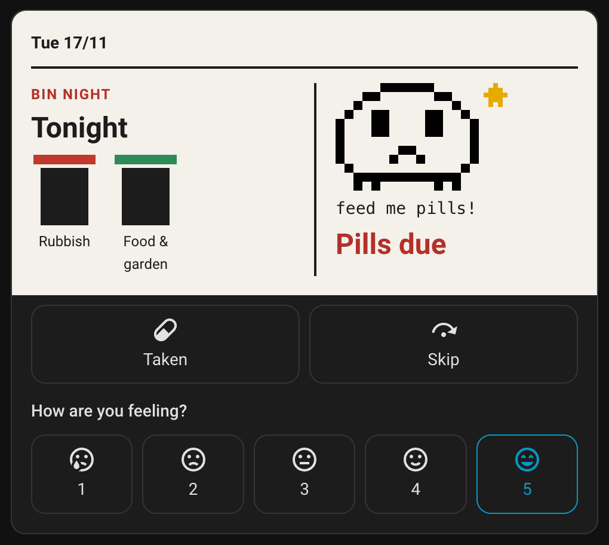
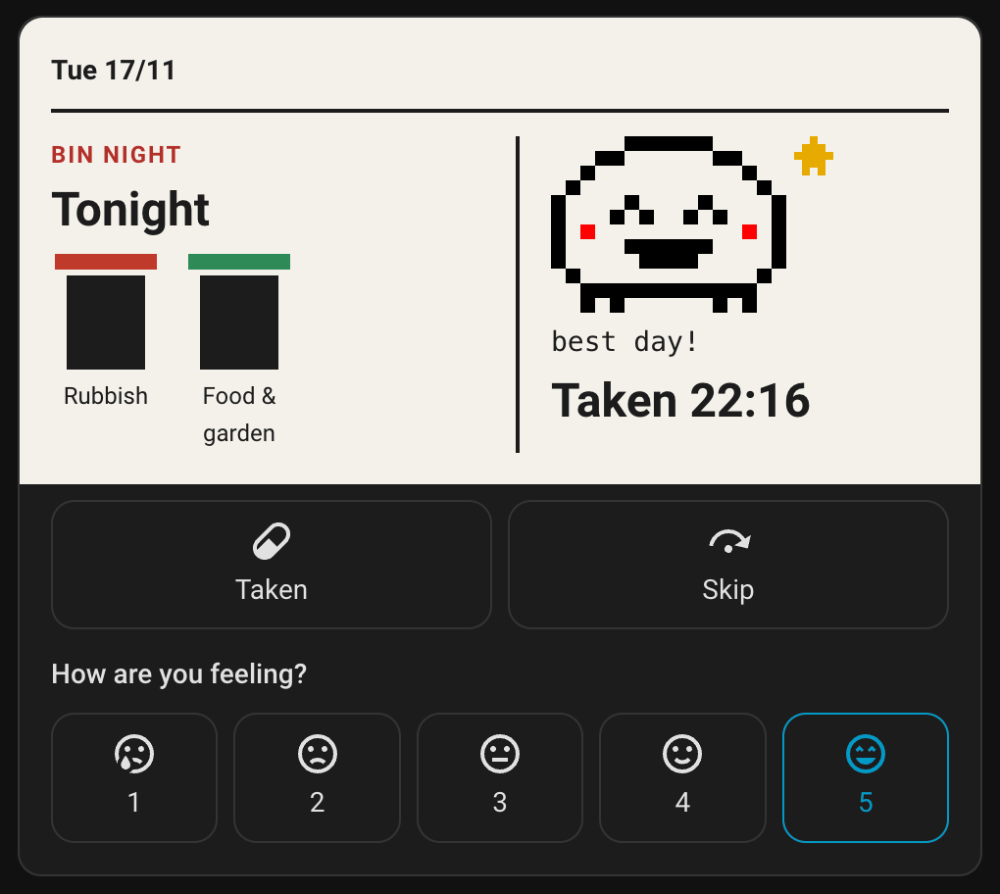

# Shanagotchi

A Home Assistant integration that reminds you to take your pills, asks how you're feeling once a day, and shows which bins go out tonight. A pixel character's mood follows how the day goes.

<p>
  
  
</p>

It needs no hardware. Everything runs inside Home Assistant, with a dashboard card and optional phone notifications.

## What it does

- **Dose reminders:** up to three doses a day. A dose stays due for a set window and reminders repeat. Shanagotchi records a dose you don't take in time as missed.
- **Daily check-in:** rate your day from 1 to 5 on the card or by replying to a phone notification.
- **Character:** hungry when a dose is due and asleep at night. At other times, its mood depends on your check-in and on whether you took or missed doses. Seven days without a missed dose earns a star.
- **Bin night:** the next collection and which bins to put out, in Australian lid colours.
- **Refill reminder:** a reminder to reorder something every set number of days.

## Install

Shanagotchi requires Home Assistant 2026.11 or later.

1. Go to **Settings > Marketplace** and select **Add from link**.
2. Enter `https://github.com/markba/shanagotchi` and select **Add**. If you're asked for a type, choose **Integration**.
3. On the Shanagotchi page, select **Install**, then restart Home Assistant.
4. Go to **Settings > Devices & services > Add integration** and select **Shanagotchi**.
5. Fill in the settings form. To change a setting later, select the integration's **Configure** button.

## Add the card

To add the card in the dashboard editor, select **Add card** and choose **Shanagotchi**. To add it in YAML, use:

```yaml
type: custom:shanagotchi-card
```

The card finds its mood sensor automatically. If you want it to use a different entity, add `entity`:

```yaml
type: custom:shanagotchi-card
entity: sensor.kitchen_shanagotchi_mood
```

The card has no visual editor, so the editor shows **Visual editor not supported** and the YAML.

If the card isn't listed after installing, refresh the browser.

## Phone notifications

To get notifications, install the Home Assistant Companion app on your phone, then choose its notify service in the settings, such as `notify.mobile_app_my_phone`. If you don't set a service, Shanagotchi sends nothing and the card still works.

Notifications carry **Taken** and **Skip** buttons for doses, a text reply for the check-in, and an **Ordered** button for refills.

## Bin night

Bin data comes from a calendar, so Shanagotchi works with any council that [Waste Collection Schedule](https://github.com/mampfes/hacs_waste_collection_schedule) supports.

1. Install Waste Collection Schedule from the Marketplace and add your council and address.
2. In the Shanagotchi settings, choose the calendar it created.

Any other calendar works too, if each collection is an event named after the bin, such as "Recycling".

Shanagotchi determines the lid colour from the event name:

| Lid | Event name contains |
|---|---|
| Red | rubbish, garbage, general, landfill, waste |
| Yellow | recycle, recycling, recyclables |
| Green | food, garden, green, fogo, organic |
| Purple | glass |

## Entities

| Entity | Description |
|---|---|
| `sensor.shanagotchi_mood` | The character's mood. Its attributes hold everything the card shows |
| `sensor.shanagotchi_dose_status` | `waiting`, `due`, `taken` or `skipped` |
| `sensor.shanagotchi_feeling` | Today's check-in score, kept in long-term statistics |
| `sensor.shanagotchi_doses_taken_today` | Doses taken today |
| `sensor.shanagotchi_doses_missed_today` | Doses missed today |
| `sensor.shanagotchi_days_without_a_missed_dose` | Current streak |
| `sensor.shanagotchi_next_bin_collection` | Date of the next collection, with the bin types as attributes |
| `binary_sensor.shanagotchi_dose_due` | On while a dose is due |
| `binary_sensor.shanagotchi_check_in_pending` | On from check-in time until you answer |
| `binary_sensor.shanagotchi_refill_due` | On when the refill interval has passed |

If you assign Shanagotchi to an area, Home Assistant adds the area to each entity ID, such as `sensor.kitchen_shanagotchi_mood`.

Use `binary_sensor.shanagotchi_dose_due` in your own automations, for example to turn on a lamp while a dose is due.

## Actions

| Action | Description |
|---|---|
| `shanagotchi.take_dose` | Marks the due dose as taken |
| `shanagotchi.skip_dose` | Marks the due dose as skipped |
| `shanagotchi.set_feeling` | Records a check-in score, `value` from 1 to 5 |
| `shanagotchi.refill_ordered` | Restarts the refill countdown from today |

`take_dose` and `skip_dose` also work in the early window before a dose, so pills you take ahead of time count for that dose.

To start refill reminders, set a refill name in the settings and run `shanagotchi.refill_ordered` once.

## If Home Assistant was off

When Home Assistant starts or wakes, Shanagotchi updates its state:

- A dose whose window is still open becomes due.
- If a dose's whole window passes while Home Assistant is off, Shanagotchi counts the dose as neither taken nor missed.
- Days when Home Assistant was off don't add to the streak.

## Changing dose times

A change to dose times takes effect as soon as you save it. If you move a dose to later in the day after you've already taken it, Shanagotchi reminds you again at the new time that day. Select **Skip** on that reminder.

## Development

```bash
uv run pytest
uv run ruff check
uv run tools/make_sprites.py   # regenerate the sprites and brand icon
```
